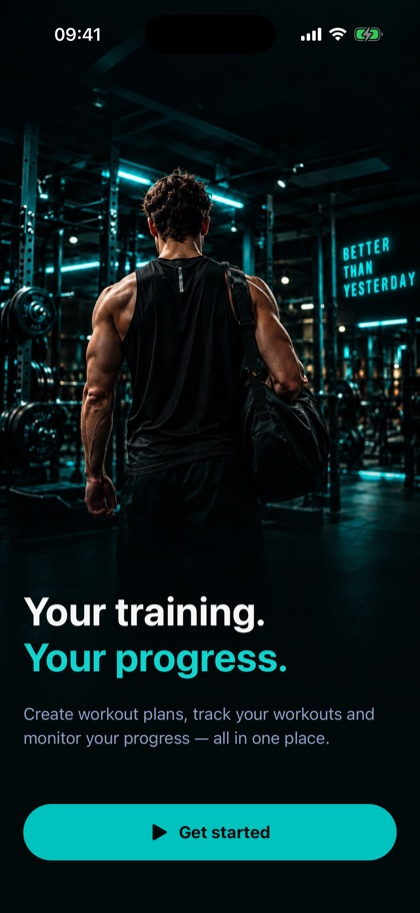
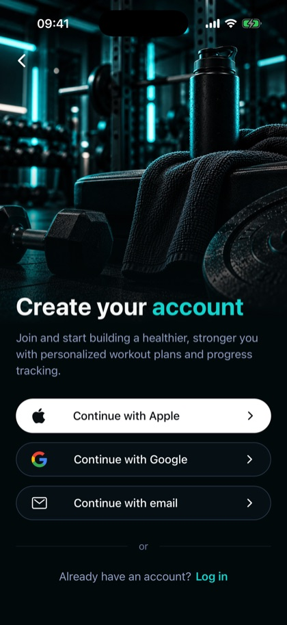
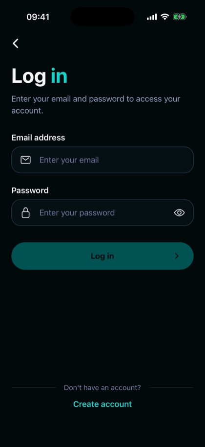

<div align="center">

# Workout App

**Plan your training, log every set, and watch your body change.**

A cross-platform workout tracker for iOS and Android, built with Expo and Supabase.


<br />

<table>
  <tr>
    <td></td>
    <td></td>
    <td></td>
  </tr>
</table>

</div>

## Features

- **Plans** – build workout plans out of training days and exercises. Pick exercises from a shared catalog grouped by muscle group or add your own, drag to reorder plans, days and exercises, and mark one plan as active.
- **Workout** – start the next training day of your active plan, log sets with reps and weight, use the rest timer, and finish the session. Past workouts are kept in a history.
- **Body** – log your weight and body measurements, follow them over time with history charts, and set a target weight to track progress toward it.
- **Profile** – manage your personal details (name, gender, age, height, target weight) and profile photo.
- **Accounts** – email/password sign-up, log-in and log-out with a persistent session. A first-launch flow takes new users from the Welcome screen to Create account or Log in.
- **Light and dark theme** that follows the system setting.

## Tech stack

| Area | Choice |
| --- | --- |
| App | [Expo](https://expo.dev) SDK 54, React Native 0.81, React 19 (with React Compiler) |
| Navigation | [Expo Router](https://docs.expo.dev/router/introduction/) with native tabs |
| Data | [TanStack Query](https://tanstack.com/query) on top of `@supabase/supabase-js` |
| Backend | [Supabase](https://supabase.com): Postgres with row-level security, Auth, Storage |
| Language | TypeScript, shared database types in `packages/shared` |
| Tooling | pnpm workspaces, Turborepo, ESLint, Jest |
| End-to-end tests | [Maestro](https://maestro.dev) |

## Repository layout

```
.
├── apps
│   ├── mobile          # Expo app (iOS and Android)
│   │   ├── app         # Expo Router routes (tabs, onboarding, plans, workout, body, profile)
│   │   ├── components  # Shared UI, incl. components/onboarding
│   │   ├── hooks       # TanStack Query hooks per resource
│   │   ├── lib         # Supabase client, auth helpers, domain logic (with unit tests)
│   │   ├── contexts    # Auth session context
│   │   └── .maestro    # End-to-end flows
│   └── web             # Next.js app (still the default scaffold)
├── packages
│   └── shared          # Generated Supabase database types
├── supabase
│   ├── migrations      # Schema, RLS policies, helper functions
│   └── config.toml
└── docs/screenshots
```

## Getting started

### Prerequisites

- Node.js and [pnpm](https://pnpm.io) (the exact version is pinned in `package.json`)
- **iOS:** macOS with Xcode and an iOS simulator
- **Android:** Android Studio, an emulator, and JDK 17
- A [Supabase](https://supabase.com) project (the free tier is enough)

### 1. Install dependencies

```bash
pnpm install
```

### 2. Set up Supabase

1. Create a project in the Supabase dashboard.
2. Link it and apply the database schema (the CLI is a dev dependency):

   ```bash
   pnpm exec supabase login
   pnpm exec supabase link --project-ref <your-project-ref>
   pnpm exec supabase db push
   ```

3. In **Authentication → Sign In / Providers**, keep the email provider enabled. For local development you will want **Confirm email** switched off, because the app does not implement email confirmation yet.

### 3. Configure the app

Create `apps/mobile/.env` with your project's URL and publishable (anon) key. Both values are safe to ship in a client app; never put a `service_role` key here.

```bash
EXPO_PUBLIC_SUPABASE_URL=https://<your-project-ref>.supabase.co
EXPO_PUBLIC_SUPABASE_PUBLISHABLE_KEY=<your-publishable-key>
```

### 4. Run the app

```bash
cd apps/mobile

pnpm ios       # builds and launches on the iOS simulator
pnpm android   # builds and launches on an Android emulator
```

The first run generates the native `ios/` and `android/` projects (they are git-ignored) and takes a few minutes. After that, `pnpm start` serves the JavaScript bundle to a development build.

To try the app without a running Metro server, build a self-contained release version:

```bash
npx expo run:ios --configuration Release
```

#### Running on a physical device

`app.json` ships with the placeholder identifier `com.anonymous.mobile` for both platforms. Set your own unique `ios.bundleIdentifier` and `android.package`, choose a signing team in Xcode for iOS, then run, for example:

```bash
npx expo run:ios --device --configuration Release
```

## Testing

```bash
pnpm --filter mobile test                  # unit tests (Jest)
pnpm --filter mobile lint                  # ESLint
pnpm --filter mobile exec tsc --noEmit     # type check
```

### End-to-end tests

Flows live in `apps/mobile/.maestro` and run with the [Maestro](https://maestro.dev) CLI, which needs Java 17+. Start a simulator or emulator with a build of the app installed, then:

```bash
pnpm --filter mobile e2e:smoke
```

Flows read the app id from `APP_ID` (default `com.anonymous.mobile`). If your build uses a different bundle identifier, pass it in:

```bash
APP_ID=com.example.workout pnpm --filter mobile e2e:smoke
```

Interactive elements carry stable `testID`s, so flows can target them on both platforms.

## Database

The schema is managed entirely through the migrations in `supabase/migrations`. Main tables: `profiles`, `workout_plans`, `workout_plan_days`, `workout_plan_exercises`, `exercises`, `workout_sessions`, `weight_logs`, `body_measurements` and `body_measurement_logs`. The tables holding user data have row-level security, so users can only read and change their own rows, and a trigger creates a `profiles` row for each new account. A small `muscle_group_translations` lookup table backs the localized exercise catalog.

After changing the schema, add a new migration and regenerate or update the types in `packages/shared/src/database.types.ts`.

## Status

The app is under active development. Not built yet:

- the onboarding questionnaire (gender, age, height, weight, target weight) – the `profiles.onboarding_completed` flag is already stored but not used
- Sign in with Apple and Google (the buttons on the Create account screen are placeholders)
- password reset
- the web app
